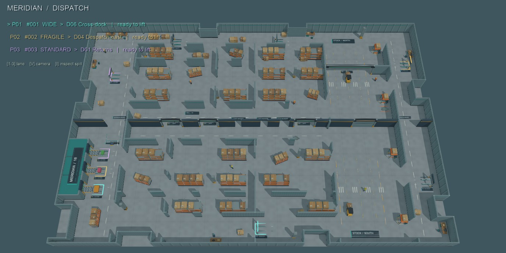
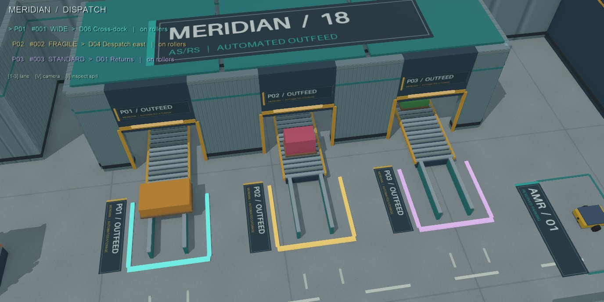

# Meridian 18 — final warehouse

Open [worlds/final_warehouse.wbt](worlds/final_warehouse.wbt) in Webots R2025a, press **Play** and click the 3D view. The robot starts in its marked **AMR / 01** parking bay beside the west storage wall. No ROS launch, downloads or rebuild are needed. The original component and integration worlds are independent.

## First delivery

1. Press **V** once to look directly at the three roller lanes. Watch a pallet emerge from behind the storage wall. An amber port light means it is feeding; green and **ready** mean the pallet is resting on the pickup rails. Each of the three lanes fills within roughly 15 simulation seconds if the mouths stay clear.
2. Read the board at the top left: `P03  #003  STANDARD  >  D01 Returns` is an example. The outline on the **pickup stand** and the light above the **destination dock** share a colour: **P01 teal, P02 amber, P03 violet**. The light over the roller opening separately tells you whether that lane is feeding or ready. Use **1**, **2** or **3** to inspect an order.
3. Approach from the east with the lift down, square to the rails. Drive between them until centred under the pallet. Release the drive controls, wait at least 0.4 s, then hold **U** until the load clears the rails. **PARCEL #… PICKED UP** appears in the centre, and the top left switches to **ON BOARD** with the parcel ID and destination. Release **U**, then reverse straight out before turning. Looking at another lane does not change which parcel is marked as carried.
4. Enter the assigned dock from its open end, centre the pallet over both rails, stop and hold **J** to lower it. Back out by about two metres. When it is level and settled on the correct stand, **PARCEL #… DELIVERED** appears in the centre for four seconds. The pallet stays visible for four seconds and fades over the next three while the dock is clear. Then the lane can issue another order. A wrong-dock delivery doesn't register, and two lanes cannot reserve the same dock.

[Pickup confirmation in Webots](docs/final_hall_carrying.jpg) · [Delivery confirmation and dock sign](docs/final_hall_delivery.jpg)

| Control | Action |
| --- | --- |
| W / S, A / D, Space | Drive forward / reverse, turn, stop |
| U / J; R | Raise / lower while stationary; print lift height |
| 1 / 2 / 3 | Focus a pickup lane and its destination |
| V | Cycle overview → outfeed → follow robot → focused destination → overview |
| I, then H | Select the next active spill; toggle its report unless cleanup has already begun |

## Floor and traffic

The [operator floor plan](docs/final_warehouse_plan.png) shows the 96 × 64 m hall. West is the storage outfeed and returns yard. The centre contains south reserve stores, north picking rooms and a packing gallery; staggered doorways create turns and loops between the racks. The outer service roads connect the open loading yards; the two east receiving docks open onto the east road. In the north stock hall G05 closes the **whole** cross-aisle. To bypass it, leave the hall through a transfer opening and return through a different one.

Eight recesses break up the exterior wall line. Inside, the northern stores have nine additional groups of palletised cartons. The workstations face staff chairs and sit against walls rather than in circulation routes. Shelves, stock, chairs and walls are physical obstacles. The floor plan is for operators and evaluation only; the robot begins with its own sensors.

For a repeatable **cargo geometry trial**, start just south of **LIGHT / SHORT** at x = −4 m and request a point directly across the divider. Compare these three permanently open crossings with the same map and seed:

| Crossing | Clear opening | Centred loads admitted by the project's circular clearance rule |
| --- | --- | --- |
| LIGHT, x = −4 m | 1.65 m | Empty robot |
| CART, x = 3 m | 1.95 m | Empty, standard, heavy, fragile |
| BULK, x = 8.5 m | 2.65 m | All five profiles, including wide and long |

These are planner clearances including the 5 cm margin. A driver aligned perfectly straight can sometimes squeeze a physical rectangle through a gap the conservative planner rejects. The wider gate and perimeter routes provide alternatives. Width markings describe the geometry; the manual controller does not select routes.

| ID | Receiving dock | Approach from |
| --- | --- | --- |
| D01 | Returns | East |
| D02 | Quality | East |
| D03 | Pack north | East |
| D04 | Despatch east | West |
| D05 | Bulk freight | West |
| D06 | Cross-dock | East |

- **Pallets:** All three ports draw from the same five [integration-world profiles](config/integration_scenario.json): standard 10 kg, wide 18 kg, long 20 kg, heavy 40 kg and fragile 8 kg. During outfeed the supervisor moves the pallet at 0.72 m/s and pauses if its next position is occupied. At the end it becomes the original physical `TestLoad`, at the same position. The unmodified robot lifts and carries it by contact. Storage machinery behind the wall and removal after receipt are simulated handoffs.
- **People:** Seven workers choose random visible destinations inside their own work areas. They avoid obstacles, other people and robot freight. At a truck crossing they look ahead, yield and, if already in its lane, step aside when there is room. The truck stops if a person is still too close. Both yield near the robot. Workers settle into a neutral standing pose whenever they stop, including when traffic is paused.
- **Forklifts:** Each starts with a shelf delivery. On subsequent floor trips, the driver samples a continuous position on reachable floor, reserves the journey and return, lowers the pallet until its runners meet the floor, and backs away. After waiting 12–24 seconds it collects the same load and returns it. These trips can leave the stock sector. The drivers account for reported spills when selecting a floor trip, yield to the robot and workers, and reserve conflicting truck routes. Candidate drops exclude gates and service approaches. A drop also has to preserve access to every robot station with the other staged load, all shutters and all spill sites treated as blocked. Floor stock has collision geometry and is visible to LiDAR; it is separate from the robot's assigned orders.
- **Gates:** G01 and G04 are presence shutters in the main divider. G05 is the presence shutter in the north forklift sector. They open for approaching entities, including the robot, and reopen if someone enters during closure. G02 and G03 are timed shutters: after a minimum of 28 s open or 14 s closed, a six-second tick can change their state. Every shutter holds open for at least 28 s once fully open and requires a clear doorway before closing. Passage lights show green when fully open, amber in motion, and orange when closed. Both the west and east 6 m bypasses are permanently open. The 1.65 m central shortcut is for empty/narrow-clearance routing trials. A raised shutter exposes the route; a moving one is not yet clear.
- **Spills:** Every 12 simulation seconds there is a 50% chance to create a spill at a vacant site and a 21% chance to report each unreported spill. A tick has a 37% chance to start cleaning one **previously reported** spill, provided that at least two will remain. The puddle and amber markings fade for three seconds. The site stays reported and counts towards the five-spill cap until the fade ends; only then can the planner use that area again. The robot learns about forbidden rectangles via reports, not LiDAR. **I/H** enables manual reporting. Pausing random ticks prevents new changes; a cleanup already underway still finishes.

## Teammate interface and trials

**Testing wheel slip:** An active puddle changes tyre contact independently at each drive wheel, even when nobody has reported it. Raw encoders still measure actual axle rotation. Wheel odometry can therefore overestimate distance or misestimate heading during slip. Grip returns when a wheel exits or cleanup finishes; past odometry error is not reset. The severe low-grip setting is a simulation stress test, not a measured friction coefficient for this vehicle. Manual control can coast through a spill; autonomous navigation should treat reported spills as forbidden. Ground truth is used only for the comparison, never to generate encoder samples. The simulator acceptance test compares the same 0.8-second acceleration from rest on dry, wet and dry floor after the delivery.

Keep the `TRANSPORT_ROBOT` instance, `extensionSlot`, and wheel, lift and LiDAR device names when substituting the team controller. The facility supervisor never steers the production robot. Automatic task selection, SLAM, cargo-aware planning, blocking a reported spill and motion limits remain the team's robot-side features.

| Device on robot | Channel | Data |
| --- | --- | --- |
| `warehouse_events` (Receiver) | 18 | UTF-8 JSON `warehouse_status` about twice a second; also `command_result` replies |
| `warehouse_commands` (Emitter) | 19 | `{"op":"report","id":"spill_1","value":true,"request_id":"trial-1"}`; `traffic` and `random_spills` each accept a boolean `value` |

Status keeps `schema_version`, `type`, `frame:"warehouse"`, `seq`, `simulation_time_s`, `reported_spills` (`id`, `center`, `size`) and `output_pallets`. Each order provides `id`, `station`, `pickup`, `profile`, `deck_size_m`, `mass_kg`, `handling`, `destination`, `dropoff` and `status` (`feeding`, `ready`, `in_transit`, `delivered`). There is no single global output profile: use the profile on the job. `gates` contains each shutter's `id`, `mode`, `state` and `open`. Points are ENU metres in the warehouse service frame; the team's localisation must align its own map before using them. No robot or actor poses, unreported spill locations, ground-truth map or collision-free route are broadcast.

Normal launches choose a fresh seed. The console prints it and `results/final/<run>/run.json` records it with the configuration and profiles. For matched trials, set `seed` to an integer in [config/final_warehouse.json](config/final_warehouse.json) and reload; `null` gives fresh runs. `G18_WAREHOUSE_SEED` can override this when starting Webots. Seed **18000** gives the pictured opening orders and P03 → D01 practice delivery. The same seed repeats random selections for the same sequence of actions and timings; different driving can change when actors yield or gates open. `events.jsonl` records order handoffs, gates, spill reports and cleanup, and stock trips. `ground_truth.csv` records robot, actor and pallet poses at roughly 1 Hz for evaluation only.

The timing, spill limits, sites, work areas and dock positions are editable in the config. After **geometry** edits, run `python webots/tools/build_final_world.py` from the repository root (Pillow required only to regenerate the artwork). Material images, signs, models and textures are local; no third-party asset download is required. The builder targets only the final scene and its assets.

## What is verified

| Check | Evidence and scope |
| --- | --- |
| Loaded route availability | A 0.4 m grid with the largest centred cargo clearance (1.132 m radius), plus a cell-corner margin, connects parking to every pickup and dock approach with **all five shutters closed and all ten possible spill rectangles blocked at once**. Final docking is a separate, straight physical manoeuvre between the rails. |
| North stock detour | From 4 m south to 4 m north of G05, the open passage is an 8 m straight drive. Closing the shutters makes the loaded robot take a detour of over 32 m on the test grid. |
| Universal docks | Webots physically settled each of the five catalogue pallets on each of the six docks: **30/30**. This checks support, height and level pose. |
| Physical delivery | Isolated R2025a run, seed 18000: a scripted test driver drove from parking, lifted the standard P03 pallet by contact, carried it across the west bypass, lowered it onto D01 and backed out. Receipt occurred at **122.4 simulation seconds**, followed by removal and a new order. No robot or delivery pallet teleport was used for that trip. Only the isolated driver has privileged pose access; this is a facility/robot integration test, not an autonomous-navigation result. |
| Traffic, spills and feedback | Both forklifts completed stock deliveries; the test robot received LiDAR returns and status packets. The simulator probe also checked matching pickup/dock lights and measured intermediate transparency for both a received pallet and a still-reported spill. Offline checks cover forklift routes, worker clearance and standing pose, gate dwell, and spill limits. |

Run `python -m unittest discover -s webots/tests -v` for the facility and integration checks. Run `python webots/tools/smoke_final.py` to repeat the simulator acceptance trip (add `--capture` for the overview and outfeed images, or `--webots PATH` for another installation). It uses a private copy under `.runtime/` and does not alter the open project. A useful next team trial is the same cross-divider delivery with the robot empty and then with a wide pallet, followed by a reported spill on the preferred route.
